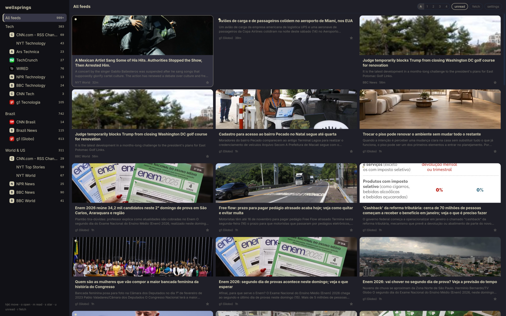

<p align="center">
  
</p>

<h1 align="center">Wellsprings</h1>

<p align="center">
  <strong>Your feeds. Your pace. Your desktop.</strong><br>
  A local-first RSS and Atom reader for Linux, built for the keyboard.
</p>

<p align="center">
  <a href="#why-wellsprings">Features</a> ·
  <a href="#getting-started">Get started</a> ·
  <a href="#keyboard-navigation">Keyboard guide</a> ·
  <a href="#roadmap">Roadmap</a>
</p>

<p align="center">
  
</p>

## Why Wellsprings?

Keep up with the sites you choose, without another account or a hosted backend.
Wellsprings stores your feeds, articles, and reading state in a local SQLite
database. Open it, catch up, and get back to your day.

| | |
| :--- | :--- |
| **Stay on the keyboard** | Move through the article grid and sidebar with `hjkl` or arrow keys. Open, read, star, and search without reaching for the mouse. |
| **Find that article** | Search titles, snippets, authors, and article bodies with SQLite FTS5. Results are ranked by relevance, with newer articles breaking ties. |
| **Organize into streams** | Group related feeds, drag streams into the order you want, and manage subscriptions in settings. |
| **Bring your feeds** | Import an OPML subscription list or export yours. Re-importing the same file doesn't duplicate feeds. |
| **Let it fetch** | Fetches every 30 minutes by default, with a configurable interval. Closing the window sends it to the tray instead of stopping the app. |
| **Match your desktop** | Follows [Omarchy](https://omarchy.org/) theme changes live. Other desktops use the built-in Dracula palette. |

Rust handles fetching and storage. Tauri provides the desktop window and tray.
React renders the reader. No separate server process is needed to run the desktop app.

## Getting started

> [!NOTE]
> Wellsprings is in early development. Install a tagged build with the
> one-liner below, or build from source.

### Quick install

```bash
curl -fsSL https://raw.githubusercontent.com/georgef-dev/wellsprings/main/install.sh | bash
```

No sudo needed. On Linux, the AppImage lands in `~/.local/bin` with a launcher
entry and icon; Debian/Ubuntu users who prefer a system package can grab the
`.deb` from the releases page instead. On macOS, the app lands in
`~/Applications`. Linux AppImages need FUSE to run, called `libfuse2` on
Debian/Ubuntu and `fuse2` on Arch. Want to read the script first? Swap
`| bash` for `| less`.

### Build and run

You'll need:

- **Rust**, installed through [rustup](https://rustup.rs/).
- **Node.js 22.12 or newer** and npm.
- **Tauri's Linux system dependencies**, including WebKitGTK 4.1.
  Follow the [prerequisites for your distribution](https://v2.tauri.app/start/prerequisites/#linux).

```bash
git clone https://github.com/georgef-dev/wellsprings.git
cd wellsprings
npm ci
npm run tauri dev
```

To build a release binary and installers:

```bash
npm run tauri build
```

Build output is under `src-tauri/target/release/`, with the `.deb` in
`src-tauri/target/release/bundle/deb/` and the AppImage in
`src-tauri/target/release/bundle/appimage/`.

### Or download a build

Tagged versions publish releases on
[GitHub Releases](https://github.com/georgef-dev/wellsprings/releases) once every
platform build succeeds: a `.deb` and an AppImage for Linux, plus macOS `.dmg`
files for Apple Silicon and Intel. The macOS builds are unsigned (no Apple
Developer account yet): on first launch, approve the app under **System
Settings → Privacy & Security → Open Anyway**.

### Make it yours

1. Open **settings** and add a feed URL, or import an OPML file.
2. Create **streams** for topics you follow and assign feeds to them.
3. Pick a column count, or leave it on **A** to adapt to the window width.
4. Press `/` to search, or start moving with `hjkl`.

Closing the window keeps Wellsprings running in the tray. Use the tray menu to
reopen it, fetch immediately, or **Quit** the app.

## Keyboard navigation

### Read and browse

| Key | Action |
| --- | --- |
| `j` / `k` or `↓` / `↑` | Move down / up |
| `h` / `l` or `←` / `→` | Move left / right |
| `o` or `Enter` | Open the selected article in the reading pane |
| `m` | Toggle read / unread |
| `s` | Toggle star |
| `u` | Toggle the unread-only filter |
| `r` | Fetch feeds now |
| `/` | Focus search |
| `Esc` | Close the article, or clear and leave the search field |

### Move between panes

Press `h` at the grid's left edge to enter the sidebar. The focused row gets an
accent outline; moving between rows doesn't change your feed selection.

| Key in the sidebar | Action |
| --- | --- |
| `j` / `k` or `↓` / `↑` | Move between feeds and streams |
| `h` or `←` | Jump to the parent stream, then **All feeds** |
| `o`, `Enter`, or `Space` | Select the focused feed or stream |
| `l`, `→`, or `Esc` | Return to the article grid |

**Try it:** `h` to the sidebar, `j` to a stream, `Enter` to select it, `l` back to
the grid. Your hands stay where they are.

## Your feeds and data

**Subscriptions travel with you.** In settings, export your feed list to
`~/Downloads/wellsprings.opml`, or import an OPML file from another reader.
Imports match feeds by URL and preserve existing stream assignments. New feeds
are fetched on the next cycle, or immediately when you press `r`.
Nested folders are flattened into their top-level stream.

Export replaces the previous `wellsprings.opml` file. OPML contains subscriptions,
not saved articles or read state.

**Your library stays local.** On Linux, the default database location is:

```text
~/.local/share/com.georgeferreira.wellsprings/wellsprings.db
```

Wellsprings doesn't require an account or send telemetry. It connects to feed
servers to fetch content, and article images and feed icons can load from remote sites.

## Roadmap

- [x] Keyboard navigation across the grid and sidebar
- [x] Full-text search
- [x] OPML import and export
- [x] CI: tests on pushes to main and pull requests, release builds on tags (Linux and macOS)
- [ ] Signed and notarized macOS builds (needs an Apple Developer account)

## Feedback

Found a bug or have an idea? [Open an issue](https://github.com/georgef-dev/wellsprings/issues).
For bugs, include your Linux distribution, desktop environment, and steps to reproduce.

## License

[MIT](LICENSE) © 2026 George Ferreira.
